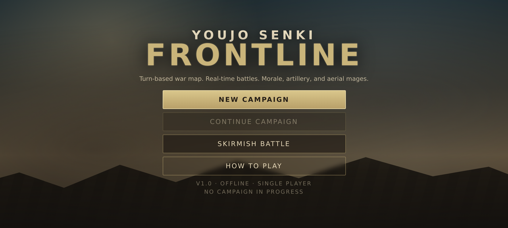
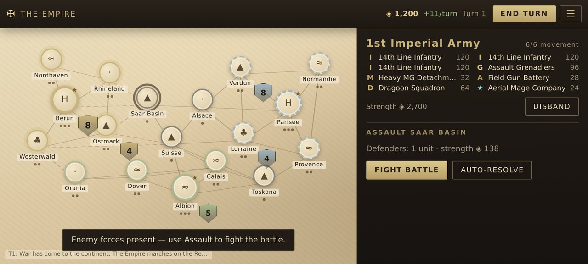
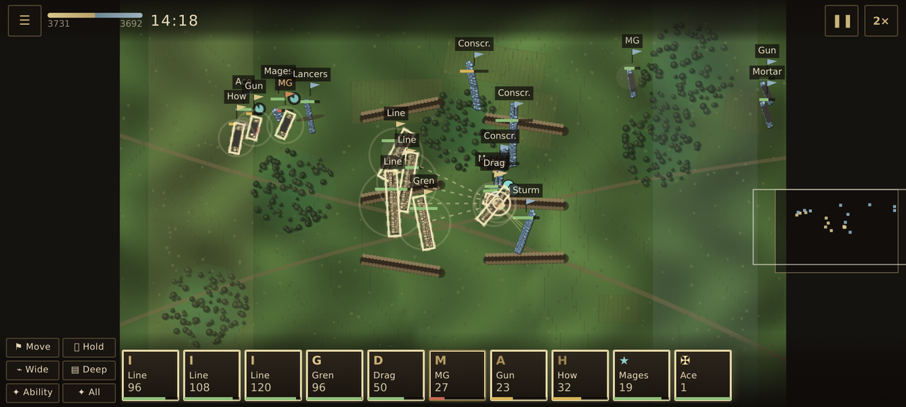
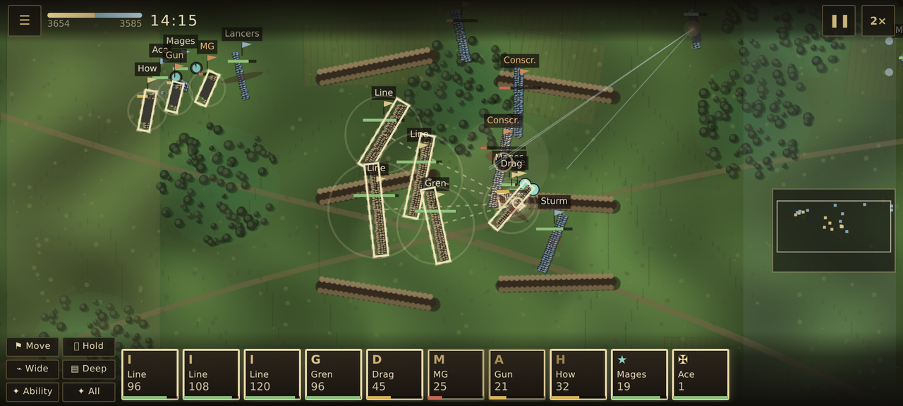

# Youjo Senki: Frontline

A Total War: WARHAMMER II–inspired strategy game for Android: a turn-based war map where
provinces, gold and armies persist, and real-time battles where morale, artillery and aerial
mages decide the day.

**APK: [`artifacts/youjo-senki-frontline.apk`](artifacts/youjo-senki-frontline.apk)** — 117 KB, signed,
minSdk 24, targetSdk 34, no permissions, fully offline.









## Install

1. Copy `youjo-senki-frontline.apk` to the phone (USB, cloud, chat attachment).
2. Open it; Android asks to allow installs from this source — allow, then install.
3. Launch **Frontline**. Landscape is recommended; the UI adapts to portrait.

The APK is signed with a local debug key. It is meant for sideloading, not Play Store
distribution; rebuild and sign with your own key for that.

## What you can do

### War map
- 18 provinces, three powers: **The Empire** (you), the **Republican Alliance**, the **Allied Kingdom**.
- Armies are 20-unit stacks with movement points. Select the shield badge, then tap an adjacent
  province to march; enemy or neutral provinces must be assaulted.
- Provinces produce gold and recruit troops. Build **Barracks** (tiers), **Foundry** (artillery),
  **Mage Academy** (aerial mages), **Industry** (+70/turn) or **Fortifications** (garrison).
- Each turn: income, upkeep, AI recruitment, AI offensives, and a battle report in the log.
- Win by holding 12 provinces or taking both enemy capitals; lose Berun and the war is lost.
- The campaign autosaves to `localStorage`; **Continue campaign** restores it after a restart.

### Battles
- Real-time with pause and 0.5×/1×/2× speed. Start in a deployment phase where you can drag units.
- Every battalion is a formation of individual soldiers: wheeling, charges, casualties and routs
  are visible, not abstract.
- **Morale beats hit points.** Flanks and rear charges, artillery shock, losses and nearby friends
  decide whether a unit wavers, breaks or rallies. Routed units can be run down.
- **Combined arms:** line infantry, grenadiers, machine guns, field guns, howitzers, dragoons,
  aerial mage companies, and an ace hero with a command aura and a heavy barrage.
- Terrain matters: woods give cover and slow movement, trenches and buildings protect defenders,
  hills extend range, roads are faster.
- Victory when the enemy army is broken, or on strength when the 15-minute timer runs out.

### Controls

| Action | Touch | Keyboard/mouse |
| --- | --- | --- |
| Select unit | Tap a card or a friendly unit | Left click / drag box |
| Move | Tap ground | Right click |
| Attack | Tap an enemy | Right click an enemy |
| Attack-move | Order bar → Move (toggles) | `A` then click |
| Hold | Order bar → Hold | `S` |
| Formation | Order bar → Wide / Deep | — |
| Cast magic | Select mage → Ability → tap target | `Q` then click |
| Pause / speed | Top bar buttons | `Space` |
| Camera | Pinch, one-finger drag | Wheel, drag |
| Select all | Order bar → All | `Tab` |

## Scale

| Metric | Value |
| --- | --- |
| Soldiers simulated per battle | ~2,400 (20 units × up to 120 men per side) |
| Unit archetypes | 8 Imperial, 8 Republican |
| Provinces / factions | 18 / 3 |
| Battle map | 560 × 380 m procedural heightmap |
| Bundle size | 85 KB JS + 23 KB CSS, zero external assets |
| APK | 117 KB |

## Develop

```bash
npm install
npm run dev      # http://0.0.0.0:3000, rebuilds on change
npm test         # headless battle + campaign simulation tests
npm run build    # minified bundle in dist/
npm run apk      # full APK build (needs JDK 17 + Android SDK 34)
```

The APK build is Gradle-free: `aapt2` → `javac` → `d8` → `zipalign` → `apksigner`
(see `scripts/build-apk.sh`). Toolchain paths come from `JAVA_HOME` / `ANDROID_SDK`
and default to `~/toolchain/jdk17` and `~/toolchain/sdk`.

```
index.html, style.css     app shell and all UI styling
src/main.ts               menus, save/load, campaign ⇄ battle routing
src/core/                 RNG, math, camera
src/data/units.ts         unit archetypes, rosters, economy helpers
src/battle/map.ts         heightmap, woods, village, trenches, cover/LOS
src/battle/battle.ts      fixed-step simulation: formations, morale, combat, projectiles
src/battle/ai.ts          tactical AI: firing line, artillery focus, cavalry flank, spells
src/battle/render.ts      baked terrain, LOD soldiers, effects, minimap
src/battle/screen.ts      battle HUD, touch/mouse input, pause, result panel
src/campaign/world.ts     provinces, armies, buildings, economy, battles, saves
src/campaign/ai.ts        strategic AI
src/campaign/screen.ts    war map, province panel, recruitment, construction
android/                  WebView wrapper (assets served from https://app.local)
tools/make_icons.py       launcher icons drawn with PIL
```

## Verification done here

- `tsc --noEmit` clean.
- 28 headless simulation assertions: battles resolve with casualties and no NaNs in 3 seeds,
  damage/shock/destruction, artillery and mage abilities, campaign recruiting, assaults,
  save/load round-trip, income, turn advancement.
- Real browser runs (headless Chromium at 915×412, touch emulation): menu → campaign → army panel
  → assault → battle → retreat → campaign, save/continue after reload, auto-resolve capture,
  two AI turns, and a 20-unit skirmish driven to melee. Zero console/page errors.
- APK: `apksigner verify` passes, `aapt dump badging` reports package `com.freebuff.youjosenki`,
  minSdk 24, targetSdk 34, label *Frontline*; bundled `game.js` hash matches the tested build.

**Not verified here:** installation/launch on a physical Android device or emulator (this
environment has no usable KVM or display). The native wrapper is intentionally minimal — a
fullscreen WebView serving `assets/www` — but the install-and-launch check is yours to do.

## Known limits / next

- No pathfinding around obstacles; terrain slows rather than blocks (deliberate for touch play).
- Campaign battles started by the AI auto-resolve rather than prompting you to defend.
- Diplomacy is war/peace only; no trade, vassals or sieges with walls and ladders.
- Natural next steps: defensive battle prompts, siege maps, hero skill trees, sound, replays.
